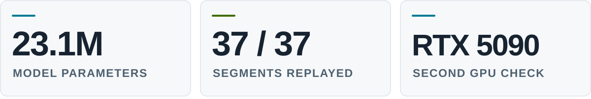

  

  <strong>OpenVerifiableLLM maintainer · GSoC 2026 @ AOSSIE</strong> 
  Master of Computer Science student · University of Sydney

  
  
  

**I build tools for verifiable training and autonomous research.**

I care about the evidence behind a result: where the data came from, how the system ran, and whether someone else can reproduce it.

## Featured work · OpenVerifiableLLM

Language-model training that people can inspect and check. My work focuses on deterministic execution, data provenance, checkpoint verification, and reproducible releases.

<a href="https://github.com/AOSSIE-Org/OpenVerifiableLLM/blob/main/docs/design/simple_run.md">
  <picture>
    <source media="(prefers-color-scheme: dark) and (max-width: 600px)" srcset="./assets/results-dark-mobile.svg" />
    <source media="(prefers-color-scheme: light) and (max-width: 600px)" srcset="./assets/results-light-mobile.svg" />
    <source media="(prefers-color-scheme: dark)" srcset="./assets/results-dark.svg" />
    
  </picture>
</a>

The project reproduced **all 37 training segments bit for bit on a second RTX 5090**. These checks cover the training computation on matching GPU hardware.

**[Source code ↗](https://github.com/AOSSIE-Org/OpenVerifiableLLM/tree/main/simple)** &nbsp;·&nbsp; **[Method and results ↗](https://github.com/AOSSIE-Org/OpenVerifiableLLM/blob/main/docs/design/simple_run.md)** &nbsp;·&nbsp; **[My contributions ↗](https://github.com/AOSSIE-Org/OpenVerifiableLLM/pulls?q=is%3Apr%20author%3Aryoari)**

## Research interests

- **Autonomous research.** Agents that choose useful experiments, run them, and retain the evidence.
- **Reliable execution.** Observable runs, controlled actions, and recovery from failure.
- **Complex systems.** Emergence, information flow, and artificial life.

## Working tools

  
  
  
  
  

> Small experiments. Clear failure records. Results others can reproduce.

Outside code, I write speculative fiction and read fantasy manhwa.
